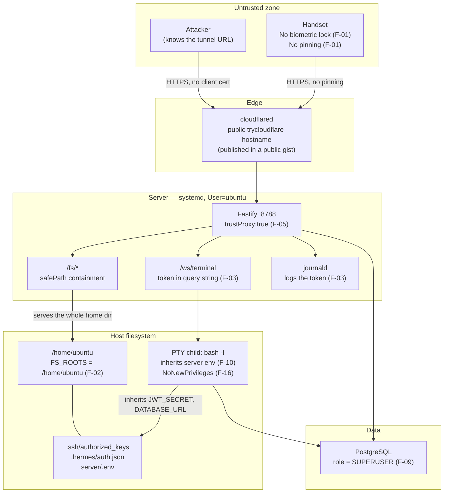

# FRIDAY One — Architecture and Trust Boundaries

**Date:** 2026-10-23
**Scope:** `~/friday-one`

This document describes the system **as implemented**, not as documented. Where the documentation and the code disagree, the code is recorded here and the discrepancy is a finding in `findings.md`.

---

## 1. Component inventory

### 1.1 Android client (Kotlin · Jetpack Compose)

| Component | Path | Role | Live? |
|---|---|---|---|
| `FridayApp` | `android/app/src/main/java/com/friday/one/FridayApp.kt` | `Application`; installs a crash handler that POSTs to `/crash` | **yes** |
| `MainActivity` | `.../MainActivity.kt` | Single activity; login screen, dashboard, files list, terminal tabs, settings | **yes** |
| `SessionStore` | `.../data/SessionStore.kt` | DataStore-backed token storage; `validToken()` proactive refresh | **yes** |
| `ApiClient` | `.../data/Api.kt` | Retrofit + plain OkHttp; bearer token per call | **yes** |
| `FilesApi` / `FsRepository` | `.../feature/files/` | Directory listing, streaming download, multipart upload | **yes** |
| `TerminalScreen` / `TerminalWebView` | `.../feature/terminal/` | WebView hosting a vendored xterm.js page; token in the WS URL | **yes** |
| `DeviceIdentity` | `.../security/DeviceIdentity.kt` | Keystore-HMAC install id + build fields → SHA-256 fingerprint | **yes** |
| `NetworkModule` | `.../data/NetworkModule.kt` | Cert pinning + `TokenRefreshAuthenticator` | **NO — dead code** |
| `AppLock` | `.../security/AppLock.kt` | `BiometricPrompt` gate | **NO — dead code** |
| `DeviceIntegrityGate` | `.../security/DeviceIntegrityGate.kt` | Emulator heuristics, key self-test, Play Integrity stub | **NO — dead code** |
| `DeviceLockManager` | `.../security/DeviceLockManager.kt` | EC P-256 keystore key, sign/verify, StrongBox detection | **NO — only referenced by `DeviceIntegrityGate`** |
| `TamperDetection` | `.../security/TamperDetection.kt` | Root/test-keys telemetry | **NO — dead code** |

### 1.2 Backend (Node.js · TypeScript · Fastify 5 · PostgreSQL 16)

| Component | Path | Role |
|---|---|---|
| `src/index.ts` | — | App assembly, CORS, rate limit, JWT, multipart, WebSocket, `authenticate` / `authenticateTrusted` decorators, route registration |
| `src/env.ts` | — | `process.loadEnvFile(server/.env)` — must be the first import |
| `src/db.ts` | — | `pg` Pool, `query()`, `withTransaction()` |
| `src/security.ts` | — | scrypt hashing, timing-safe verify, opaque tokens, SHA-256, HMAC fingerprint pepper |
| `src/loginGuard.ts` | — | Per-account lockout (DB) + per-IP throttle (memory) |
| `src/trust-device.ts` | — | Out-of-band CLI to trust/revoke/prune devices |
| `src/seed-owner.ts` | — | Create/reset the owner account; disables all other accounts |
| `src/routes/auth.ts` | — | register, login, refresh, logout, `/me`, device list/approve/revoke |
| `src/routes/files.ts` | — | `/fs/list`, `/fs/download`, `/fs/upload`, `/fs/search`, `/files` — all behind `safePath` |
| `src/routes/terminal.ts` | — | `/ws/terminal` (WebSocket), `/ws/terminals` |
| `src/routes/system.ts` | — | `/system` telemetry, `/system/audit`, `/system/ping` |
| `src/routes/crash.ts` | — | `/crash` (unauthenticated write, authenticated read) |
| `src/schema.sql` | — | users, devices, sessions, files, crash_reports, audit_log |
| `src/schema-device-binding.sql` | — | Adds `public_key`, `public_key_id`, `key_security_level`, `integrity_verdict`, `key_bound_at` to `devices` — **never read or written by any code** |

### 1.3 Infrastructure

| Component | Path | Role |
|---|---|---|
| `friday-one-api.service` | `infra/systemd/` | Runs the server as `ubuntu`; `ProtectSystem=strict`, `ProtectHome=read-only`, `NoNewPrivileges=true`, `ReadWritePaths=/home/ubuntu/friday-one` |
| `friday-one-tunnel.service` | `infra/systemd/` | cloudflared quick tunnel → `http://127.0.0.1:8787` |
| `friday-endpoint-publisher.{service,timer}` | `infra/systemd/` | Every 5 min, publishes the tunnel URL to a public gist |
| `docker-compose.yml` | `infra/` | `postgres:16-alpine` on `127.0.0.1:5433` |
| `scripts/tunnel.sh` | — | Waits for `/health`, then `cloudflared tunnel --url` |
| `scripts/setup-named-tunnel.sh` | — | One-way migration to a named tunnel at `friday.knistudio.in` |
| `scripts/publish-endpoint.sh` | — | Parses `/tmp/cf-tunnel.log`, writes the gist, verifies it is live |

---

## 2. Deployment reality vs. deployment intent

| Component | Intended | Actual (2026-10-23) |
|---|---|---|
| API service | systemd, enabled, on `:8788` | **`not-found` in systemd.** `curl 127.0.0.1:8788/health` → `000` (nothing listening) |
| Tunnel service | systemd, enabled | **`not-found` in systemd.** No cloudflared process running |
| Endpoint publisher | timer every 5 min | **installed and active**, runs successfully, but republishes a URL for a tunnel that no longer exists |
| Published endpoint | live | `https://society-tucson-achieve-course.trycloudflare.com` → **HTTP 530** (origin down) |
| Postgres | `friday-pg` on `127.0.0.1:5433` | **running and healthy** (3h uptime) |
| Git history | — | **no `.git` directory** |
| CI | — | **none** |

The systemd unit files exist in `infra/systemd/` but were never installed (only `friday-endpoint-publisher.*` was, on 2026-10-23 09:59). `friday-console.service` — the pattern the units were modelled on — is installed and running, but it is a different service.

**Consequence for this audit:** the system was validated by booting the real `src/index.ts` against an isolated Postgres database (`friday_audit`, role-owned) and a throwaway filesystem root, on ports 8789-8799. Every finding below is a property of the source, which is the code that would be deployed.

---

## 3. Data flow — authenticated session

```
┌──────────────────────────┐
│  Android handset         │
│  MainActivity            │
│   └─ SessionStore        │  DataStore: access_token, refresh_token, email, display_name, base_url
│   └─ ApiClient (Retrofit)│  OkHttp, NO pinning, bearer per call
└───────────┬──────────────┘
            │ HTTPS (via Cloudflare tunnel)
            │ Authorization: Bearer <JWT 15m>
            ▼
┌──────────────────────────────────────────────────────────────┐
│  cloudflared  (trycloudflare quick tunnel, public hostname)  │
└───────────┬──────────────────────────────────────────────────┘
            │ HTTP 127.0.0.1:8788
            ▼
┌──────────────────────────────────────────────────────────────┐
│  Fastify  (systemd: User=ubuntu, NoNewPrivileges=true,       │
│            ProtectSystem=strict, ProtectHome=read-only)      │
│                                                               │
│  authenticate          → jwtVerify()                         │
│  authenticateTrusted   → jwtVerify() + devices.trusted/revoked│
│                                                               │
│  /auth/*      register | login | refresh | logout | /me       │
│  /fs/*        list | download | upload | search  [trusted]     │
│  /system*     telemetry | audit | ping                        │
│  /crash       write (no auth) | read [trusted]                │
│  /ws/terminal WebSocket, JWT in query string, [trusted]       │
└───────────┬──────────────────────────────────────────────────┘
            │ SQL (parameterised, pg)
            ▼
┌──────────────────────────────────────────────────────────────┐
│  PostgreSQL 16  (docker, 127.0.0.1:5433)                    │
│  role `friday` = SUPERUSER, CREATEDB, REPLICATION, BYPASSRLS │
│  tables: users, devices, sessions, files, crash_reports,      │
│          audit_log                                           │
└──────────────────────────────────────────────────────────────┘
```

---

## 4. Data flow — terminal (highest-risk path)

```
Handset (WebView, file:///android_asset/terminal/index.html)
   │  page reads ?ws=<wss://host/ws/terminal?kind=shell&token=<JWT>>
   │  xterm.js renders; keystrokes → ws.send(data)
   ▼
Fastify websocket handler (server/src/routes/terminal.ts)
   │  1. app.jwt.verify(q.token)            ← token is in the URL
   │  2. SELECT trusted, revoked FROM devices WHERE id=did AND user_id=sub
   │  3. COMMANDS[kind]  →  { hermes, opencode, shell }
   │  4. spawn("script", ["-qfc", "stty rows R cols C; exec <cmd>", "/dev/null"])
   │     env: { ...process.env, TERM, COLUMNS, LINES, COLORTERM, FORCE_COLOR }
   ▼
┌──────────────────────────────────────────────────────────────┐
│  PTY child: `bash -l` (or `hermes --tui` / `opencode`)         │
│  uid=1001 (ubuntu), cwd=/home/ubuntu                          │
│  INHERITS: JWT_SECRET, DATABASE_URL, FINGERPRINT_PEPPER,      │
│            every other var in the server's environment         │
│  READS:   ~/.ssh/authorized_keys, ~/.hermes/auth.json,        │
│            friday-one/server/.env  (all inside FS_ROOTS)       │
│  sudo -n: BLOCKED by NoNewPrivileges=true (verified)          │
└──────────────────────────────────────────────────────────────┘
```

**Trust boundary note.** The `kind` parameter is an allowlist lookup (`COMMANDS[q.kind ?? "shell"]`), so a client cannot inject an arbitrary program — verified: `kind=shell;id`, `kind=shell%20;id` and `kind=hermes --help` were all rejected with close code `4400`. But `COMMANDS.shell = "bash -l"` **is** a general-purpose login shell, and the audit prompt's own instruction is correct: an allowlisted executable name does not make a login shell a restricted command. The honest description of this feature is **remote shell as the `ubuntu` user**, gated by device trust and bounded by `NoNewPrivileges`.

---

## 5. Data flow — file transfer

```
Handset → POST /fs/upload (multipart: dest, file)
   │  1. authenticateTrusted
   │  2. safePath(dest)  → realpath, containment vs FS_ROOTS
   │  3. filename = basename(data.filename), control chars stripped
   │  4. stream to .upload-<rand>.tmp in the SAME directory (atomic rename)
   │  5. rename(tmp, target)
   │  6. INSERT into files (ON CONFLICT user_id,path DO UPDATE)
   ▼
Filesystem at FS_ROOTS

Handset → GET /fs/download?path=...
   │  1. authenticateTrusted
   │  2. safePath(path)  → realpath, containment vs FS_ROOTS
   │  3. stat → must be a regular file, ≤ MAX_DOWNLOAD_BYTES
   │  4. Range support (single range only; multi-range → 416)
   ▼
File bytes streamed to the client
```

**The containment logic is sound.** `safePath` resolves the candidate, `realpath()`s it (collapsing `..`, symlinks and `/proc/self/cwd` tricks), falls back to validating the *parent* for a non-existent leaf, and requires the result to equal or be under a root. Every traversal and symlink case tested was rejected. The problem is not the mechanism — it is that **`FS_ROOTS` is `/home/ubuntu`**, so "inside the roots" includes the owner's SSH keys, agent credentials and the server's own secret file.

---

## 6. Trust boundary register

| # | Boundary | Crossed by | Enforcement | Assessment |
|---|---|---|---|---|
| B1 | Internet → Cloudflare → Fastify | Anyone who learns the tunnel hostname | TLS + app-layer auth | **Weak on discovery** — the hostname is published in a public gist and changes on each restart; a hostile party who learns it faces only the app's auth. No IP allowlist, no Cloudflare Access, no mTLS. |
| B2 | Unauthenticated → authenticated | `/auth/*` | scrypt password + per-account lockout + per-IP throttle | **Sound**, except the per-IP throttle is bypassable (F-05) and registration fails open (F-04) |
| B3 | Authenticated → trusted device | `/fs/*`, `/system/audit`, `/crash` GET, `/ws/terminal` | `devices.trusted && !devices.revoked` | **Sound in the server**; undermined by F-06/F-08 (a forged `did` passes) and by F-01 (the client cannot actually be bound to a device) |
| B4 | Trusted session → filesystem | `/fs/*` | `safePath` containment | **Mechanism sound, configuration wrong** (F-02) |
| B5 | Trusted session → host shell | `/ws/terminal` | allowlist on `kind` + trust gate | **By design a general shell**; bounded by `NoNewPrivileges` (F-16), unbounded by anything else |
| B6 | Server process → database | `pg` | parameterised SQL, TCP loopback only | **SQL sound; the role is a superuser** (F-09) |
| B7 | Server process → secrets on disk | `server/.env`, `~/.hermes/auth.json` | file permissions (600) + `ProtectHome=read-only` | **Effective at the OS layer for the systemd unit** — but the *app* serves these files over HTTP (F-02), which bypasses the filesystem boundary entirely |
| B8 | App → server | HTTPS | **no certificate pinning** (F-01) | **Absent** |
| B9 | Phone → local storage | `SessionStore` | DataStore (app-private), backup excluded | **Sound** |
| B10 | Unauthenticated → owner console | `POST /crash` | rate limit only | **Open by design** (F-12) — an unauthenticated party can write rows the owner will read |

**The central architectural observation:** the design is *defence-in-depth around a single trust anchor* — the `ubuntu` user's home directory. The server, the agents (Hermes, OpenCode) and the phone all run as or reach the same user with the same filesystem view. `NoNewPrivileges` and `ProtectHome` are the only two barriers between "authenticated session" and "the owner's entire home directory", and the HTTP file API walks straight past the second one.

---

## 7. Secret flow map (values never printed)

| Secret | Lives in | Flows to | Protection |
|---|---|---|---|
| `JWT_SECRET` | `server/.env` (0600) | server memory → **terminal child env** → **server log**? no → **`/fs/download` response** | 0600 + `ProtectHome=read-only`; **leaks to the terminal child (F-10) and to any trusted client via `/fs/download` (F-02)** |
| `DATABASE_URL` (DB password) | `server/.env`, `infra/.env` | server → pg client → **terminal child env** → `/fs/download` | same as above |
| `FINGERPRINT_PEPPER` | `server/.env` | server memory → **terminal child env** | same as above |
| `POSTGRES_PASSWORD` | `infra/.env` (0600) | docker-compose → container | 0600; the DB role is a **superuser** (F-09) |
| Device refresh token | DataStore on device | device → `/auth/refresh` over TLS | app-private storage, no backup; fingerprint-bound server-side |
| Access token (JWT) | DataStore on device | device → `Authorization` header, **and** `?token=` in the WS URL | **logged to the journal (F-03)** |
| `~/.hermes/auth.json` (agent credentials) | 0600 on disk | **served over HTTP by `/fs/download`** | 0600 only; the app bypasses it (F-02) |
| `~/.ssh/authorized_keys` | 0600 on disk | **served over HTTP by `/fs/download`** | 0600 only; the app bypasses it (F-02) |
| Cloudflare tunnel hostname | public gist | published every 5 min | public by design (no token in it) — but it is the attacker-facing address (F-22) |

**Chained escalation (the real risk):**
```
/fs/download  →  server/.env  →  JWT_SECRET
             →  mint a token with any (sub, did)
             →  authenticateTrusted passes (did is only DB-checked, never cryptographically verified)
             →  /fs/download  +  /ws/terminal
```
F-06 and F-08 are the two links that make the `did` in a JWT untrustworthy. Fixing the *server-side* signature verification (Stage 2.B of the brief) closes the chain; the client-side key work in F-01 is what makes it meaningful.

---

## 8. Mermaid — trust boundaries



---

## 9. Process execution inventory

| Process | Spawned by | Identity | Env | Cwd | Notes |
|---|---|---|---|---|---|
| `node`/`npm exec tsx src/index.ts` | systemd | `ubuntu` (uid 1001) | full server env incl. `JWT_SECRET` | `/home/ubuntu/friday-one` | `NoNewPrivileges`, `ProtectSystem=strict`, `ProtectHome=read-only`, `ReadWritePaths=/home/ubuntu/friday-one` |
| `script -qfc … /dev/null` | terminal route | `ubuntu` | **inherits full server env** | `/home/ubuntu` | the PTY wrapper |
| `bash -l` | `exec` inside the PTY | `ubuntu` | same | `/home/ubuntu` | **general-purpose shell** |
| `hermes --tui` | `exec` inside the PTY | `ubuntu` | same | `/home/ubuntu` | Hermes agent; reaches MCP servers, `~/.hermes`, and the host |
| `opencode` | `exec` inside the PTY | `ubuntu` | same | `/home/ubuntu` | OpenCode agent; same reach |
| `cloudflared` | systemd | `ubuntu` | tunnel env | — | |
| `postgres` | docker | container | `POSTGRES_PASSWORD` | — | role `friday` is a superuser |

**Every process runs as the same user with the same filesystem view.** `ProtectHome=read-only` prevents *writes* outside the project tree; it does not prevent reads, and the HTTP file API performs reads on the app's behalf.

---

## 10. What the documentation claims that the code does not do

| Claim | Source | Reality |
|---|---|---|
| "certificate pinning (loopback exempt)" | `docs/TASKS.md` WS3 | Class exists; **never called**; pin list empty with a `TODO` |
| "biometric gate … fails closed" | `docs/TASKS.md` WS3 | Class exists; **never called** |
| "root/emulator detection reported as telemetry" | `docs/TASKS.md` WS3 | Class exists; **never called** |
| "device binding" / "keystore-backed install id" | `schema.sql`, `docs/SHARED.md` | A **fingerprint**, not a cryptographic binding. `public_key` columns exist and are never used |
| "device trust is enforced server-side" | `docs/SHARED.md` | **True** — the check is real. It is just checkable with a forged `did` (F-06/F-08) |
| "Trust is enforced server-side on the terminal socket and on refresh, so this genuinely gates access" | `trust-device.ts` | **True** |
| "The server reads it, never prints or commits it" | `launch_team.sh` WS4 | **True** for the repo; but the file is *served over HTTP* by `/fs/download` (F-02) |
| "the JWT is short-lived (15m) and checked before any process is spawned" | `terminal.ts` | **True** — but the token is written to the log (F-03) |
| "Registration is closed to anyone but the owner" | `auth.ts` | **Only when `ALLOWED_EMAILS` is non-empty** — empty disables the check (F-04) |
| "the path jail" works | `docs/SHARED.md` | **True** — the mechanism is correct; the root is too wide (F-02) |
